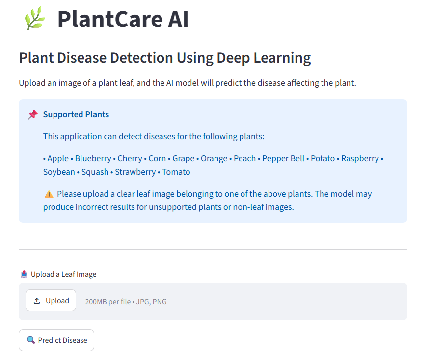
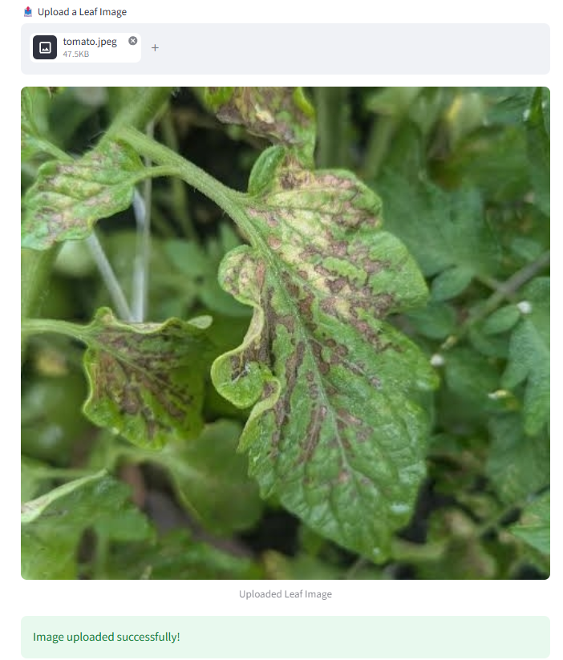
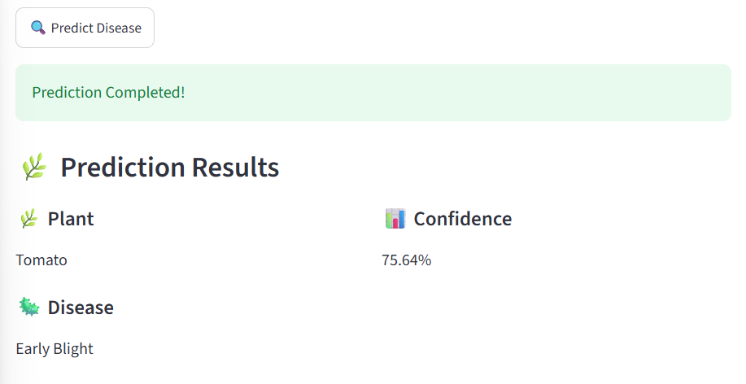
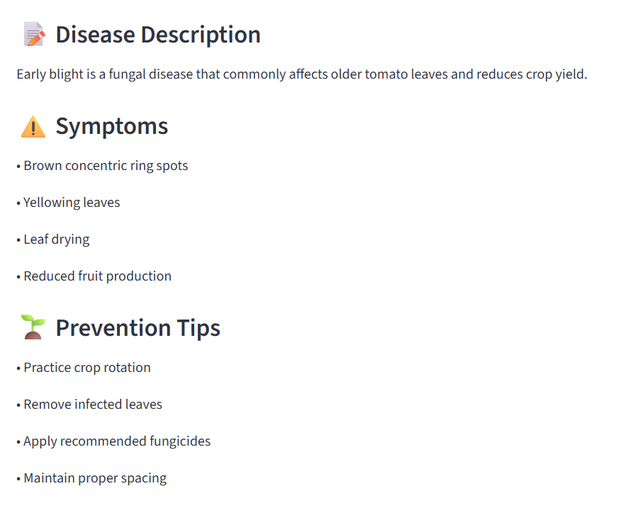

# 🌿 PlantCare AI

An AI-powered web application for detecting plant leaf diseases using Deep Learning. Users can upload a plant leaf image to instantly identify the disease, view the prediction confidence, and receive disease descriptions, symptoms, and prevention tips.

---

## 📌 Project Overview

Plant diseases significantly impact crop quality and agricultural productivity. Early disease detection helps farmers and growers take timely action to reduce crop losses.

**PlantCare AI** is a Deep Learning-based application built using **TensorFlow/Keras** and **Streamlit**. It uses a Convolutional Neural Network (CNN) trained on the **PlantVillage** dataset to classify plant leaf diseases.

---

## 🚀 Web Application

The application provides a simple and interactive web interface where users can:

- Upload a plant leaf image
- Predict the disease using a trained CNN model
- View the confidence score
- Read disease descriptions
- Learn common symptoms
- Get prevention tips

---

## ✨ Features

- 🌿 Plant leaf disease detection
- 🤖 CNN model built with TensorFlow/Keras
- 📊 Prediction confidence score
- 📖 Disease description
- ⚠️ Disease symptoms
- 🌱 Prevention recommendations
- 🎨 Clean and user-friendly Streamlit interface
- 📱 Responsive web application

---

## 🌱 Supported Plants

PlantCare AI supports disease detection for the following plants:

- Apple
- Blueberry
- Cherry
- Corn (Maize)
- Grape
- Orange
- Peach
- Pepper Bell
- Potato
- Raspberry
- Soybean
- Squash
- Strawberry
- Tomato

The trained model can classify **38 different plant disease classes**.

> **Note**

> This model is trained only on the PlantVillage dataset. Predictions are most reliable for plant species and diseases included in the training dataset.

---

## 🧠 Model Information

| Item | Details |
|------|---------|
| Model Architecture | Convolutional Neural Network (CNN) |
| Framework | TensorFlow / Keras |
| Input Image Size | 224 × 224 pixels |
| Dataset | PlantVillage |
| Plant Species | 14 |
| Disease Classes | 38 |
| Prediction Output | Plant Name, Disease Name & Confidence Score |

---

## 📂 Project Structure

```text
PlantCare-AI/
│
├── app/
│   ├── app.py
│   ├── prediction.py
│   └── disease_info.py
│
├── models/
│   └── best_model.keras
│
├── notebooks/
│   ├── 01_dataset_analysis.ipynb
│   ├── 02_data_preprocessing.ipynb
│   ├── 03_model_building.ipynb
│   └── 04_model_evaluation.ipynb
│
├── reports/
│   ├── evaluation/
│   └── figures/
│
├── data/
│   ├── raw/
│   ├── processed/
│   └── metadata/
│
├── README.md
├── requirements.txt
└── .gitignore

> **Note**

> The `data/raw`,`data/processed` directory and `.venv/` are excluded from the GitHub repository using `.gitignore`. Users should download the dataset separately and create their own virtual environment before running the project.

```

---

## 📊 Model Performance

The CNN model was trained and evaluated using the PlantVillage dataset.

**Evaluation Metrics**

- Accuracy
- Precision
- Recall
- F1-Score


---

## 📚 Dataset

This project uses the **PlantVillage Dataset**, which contains healthy and diseased leaf images across multiple crop species.

Dataset includes:

- 🌱 14 Plant Species
- 🦠 38 Disease Classes
- 🖼️ Thousands of labeled leaf images

---

## 🛠️ Technologies Used

- Python
- TensorFlow
- Keras
- Streamlit
- NumPy
- Pillow
- Matplotlib
- Scikit-learn
- Git
- GitHub

---

## 🚀 Installation

### Clone the Repository

```bash
git clone https://github.com/Anshika-Gangwar/PlantCare-AI.git
```

```bash
cd PlantCare-AI
```

### Create a Virtual Environment

```bash
python -m venv .venv
```

### Activate the Virtual Environment

#### Windows

```bash
.venv\Scripts\activate
```

#### Linux / macOS

```bash
source .venv/bin/activate
```

### Install Dependencies

```bash
pip install -r requirements.txt
```

---

## ▶️ Run the Application

```bash
streamlit run app/app.py
```

The application will launch in your default web browser.

---

## 🌐 Live Demo

> https://plantcare-ai-anshika.streamlit.app/

---

## 📸 Application Screenshots

### 🏠 Home Page

> 

### 📤 Upload Image

> 


### 🔍 Prediction Result

> 

### 📖 Disease Information

> 

---

## 🖼️ Sample Prediction

| Plant | Disease | Confidence |
|--------|----------|------------|
| Tomato | Early Blight | 75.64%% |

The application also provides:

- Disease Description
- Common Symptoms
- Prevention Tips

---

## 🔮 Future Improvements

- Support more plant species
- Mobile application
- Real-time camera detection
- Fertilizer recommendation system
- Weather-based disease prediction
- Multi-language support

---

## 👩‍💻 Author

**Anshika Gangwar**

Machine Learning & Deep Learning Project

---

## ⭐ Acknowledgements

- PlantVillage Dataset
- TensorFlow
- Streamlit
- Open Source Community